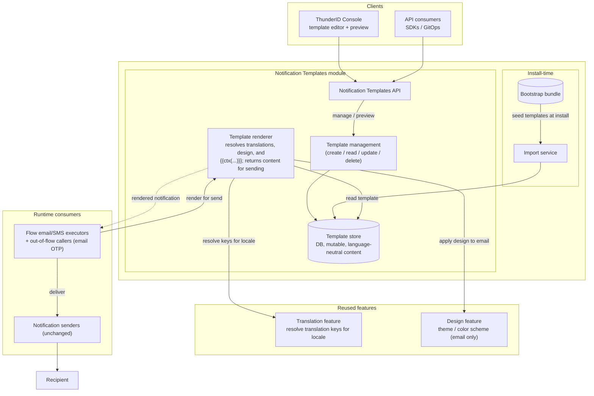

# Notification Templates Specification

- **Status:** Draft
- **Version:** 0.2
- **Related documents:** [Feature issue #5337](https://github.com/thunder-id/thunderid/issues/5337), [design discussion #5388](https://github.com/thunder-id/thunderid/discussions/5388)

## Summary

ThunderID ships fixed email and SMS templates. Changing their content requires editing server files and restarting the service. Administrators cannot manage or preview templates through the Console or an API. This specification adds runtime template management and live previews, with language and design support: a template references translation keys and a design rather than embedding its own copy or branding. Authoring new translations or customizing the design itself is out of scope for this phase; a template reuses the translations and designs the Translation and Design features already provide.

Each template is language-neutral: its message content references translation keys rather than storing separate content for each language. The Design feature supplies the applicable design when an email is rendered. The template stores a color scheme selection and references a design rather than embedding the design itself.

A flow node selects the template to send. Notifications dispatched outside a flow, for example the email OTP authentication endpoint, select a managed template by a fixed handle (`otp`) through the same renderer. During execution, ThunderID renders in a fixed order: first it resolves the `{{t(...)}}` translation keys for the requested language (falling back to the system language), then it resolves the `{{design(...)}}` tokens (email body only), and finally it substitutes the `{{ctx(...)}}` runtime values, HTML-escaping them in an HTML body. It then sends the notification. Resolving the recipient's own language is future work; this phase renders in the configured system default language.

## Architecture

A template belongs to a notification channel, currently email or SMS. An administrator selects a template for a flow’s notification node, and the corresponding channel executor uses it. An email executor cannot use an SMS template, or vice versa.

Template content belongs to an organization unit and is independent of language and design. Its message content references translation keys; the resolved translation text, which can contain `{{ctx(...)}}` placeholders, is produced by the Translation feature at render time. The template stores the selected color scheme; the Design feature supplies the applicable design when the notification is rendered or previewed.

The Notification Templates module manages templates and coordinates rendering. It uses the Translation feature to resolve localized text and the Design feature to apply the relevant design. Runtime consumers invoke the template renderer, which returns the fully resolved notification content ready for sending. They do not call the Translation or Design features themselves to resolve template placeholders; the renderer has already applied them.

Templates required by flows, which are themselves created at bootstrap, are imported through the existing bootstrap path. After import, they are ordinary editable templates. Features installed or enabled later create any additional templates they require.



| Component | Responsibility |
|---|---|
| Notification Templates module | Manage templates and coordinate rendering |
| Template renderer | Return fully resolved notification content (translations and design applied) for sending, so runtime consumers do not call the Translation or Design features directly |
| Template store | Persist templates and their content |
| Bootstrap and import | Seed templates required by bootstrapped flows as declarative resources (`resource_type: notification_template`) |
| Translation feature | Resolve `notification`-namespace translation keys for the target language (system default this phase) |
| Design feature | Apply the applicable design based on given themes, color schemes |
| Flow executors | Select a template and, through the template renderer, supply the design theme, language, and flow context |
| Notification senders | Deliver rendered email or SMS |
| Console | Manage templates and show template and flow previews |

## Detailed design

### Module and interfaces

The feature lives in the `internal/notificationtemplate` package (a single flat package with the API handler, service, DB store, cache-backed store, and renderer). It reuses `internal/system/i18n/mgt` for translations, `internal/design/resolve` for design, `internal/notification` for delivery, and `internal/system/importer` for declarative bootstrap import.

Management goes through the service interface; runtime consumers (flow executors and out-of-flow callers) depend only on the narrow renderer interface, never on the management service directly.

```go
// Management surface.
type NotificationTemplateServiceInterface interface {
    ListTemplates(ctx, channel ChannelType, limit, offset int) (*TemplateListResponse, *ServiceError)
    CreateTemplate(ctx, channel ChannelType, req CreateTemplateRequest) (*Template, *ServiceError)
    GetTemplate(ctx, channel ChannelType, id string) (*Template, *ServiceError)
    GetTemplateByHandle(ctx, channel ChannelType, handle string) (*Template, *ServiceError)
    ValidateTemplate(ctx, channel ChannelType, req CreateTemplateRequest) *ServiceError
    UpdateTemplate(ctx, channel ChannelType, id string, req UpdateTemplateRequest) (*Template, *ServiceError)
    DeleteTemplate(ctx, channel ChannelType, id string) *ServiceError
}

// Runtime renderer: the only surface flow executors and out-of-flow callers use.
type TemplateRendererInterface interface {
    Resolve(ctx, channel ChannelType, handle string, in RenderInput) (*ResolvedContent, *ServiceError)
}
```

DTO and model shapes:

```go
type Template struct {
    ID, OUID, Handle, DisplayName, Description string
    Design  *TemplateDesign  // email only; nil for SMS
    Content TemplateContent
}
type TemplateContent struct { Subject, Body string } // Subject empty for SMS
type TemplateDesign  struct { ColorScheme string }   // "light" | "dark"

type CreateTemplateRequest struct { // OUID is required and immutable, set only at creation
    OUID, Handle, DisplayName, Description string
    Design  *TemplateDesign
    Content TemplateContent
}
type UpdateTemplateRequest struct { // Handle omitted: it is immutable
    DisplayName, Description string
    Design  *TemplateDesign
    Content TemplateContent
}

// Render input supplied by the caller; ResolvedContent is returned ready to send.
type RenderInput    struct { Locale string; Data map[string]string; ThemeID string }
type ResolvedContent struct { Subject, Body string }
```

`channel` is taken from the request path, not the body. Delivery clients expose their own provider interfaces in `internal/notification/client` (`EmailClientInterface`, `MessageClientInterface`).

### Template configuration and management

Each template belongs to an organization unit (`ouId`, required and immutable) and has one editable content definition. The handle is unique per channel across the deployment, so a flow's reference by handle resolves to a single template; per-organization-unit or per-application overrides of the same handle are not supported in this phase.

Administrators can create, list, read, update, and delete templates, including those created at bootstrap. There is no system or custom classification: all templates follow the same management rules. A template cannot be deleted while a flow references it. If deletion is rejected, the template and flow remain unchanged.

The creation wizard offers sample templates, including samples for templates initially created at bootstrap. A sample supplies starting content for a new template and has no special status after creation.

### Content and localization

An email template has a subject and body. An SMS template has a body only. A content field is a string that can embed three kinds of placeholder, none, one, or many, alongside literal text:

- `{{t(...)}}`: a translation key, resolved to localized text by the Translation feature.
- `{{ctx(...)}}`: a runtime value the sender injects, substituted at send time (see below). Only keys the runtime actually provides are accepted; the current set is `appName`, `otpCode`, `expiryTime`, `magicLink`, `inviteLink`, and `bindingMessage`. The Console token catalog offers the same set, and the backend keeps the authoritative list in sync with the flow executors and the authn service that populate these values.
- `{{design(...)}}`: a design token (for example `{{design(palette.primary.main)}}`), resolved against the applicable design. Allowed only in the email body, never in a subject or in SMS.

Placeholders are validated when a template is created or updated. A malformed or unsupported placeholder, a `{{design(...)}}` placeholder in a subject or in SMS, or a `{{ctx(...)}}` key outside the set the runtime injects is rejected with `400` before the template is stored, so a template that would fail to render, or leave a literal placeholder in a sent message, cannot be saved.

The templates seeded at bootstrap are authored entirely with placeholders rather than literal values: every piece of copy is a `{{t(...)}}` key and every color, including the email background (`{{design(palette.background.default)}}`), is a `{{design(...)}}` token. The shipped defaults therefore localize and follow the selected design theme (light or dark) out of the box, with no hardcoded copy or colors.

Template keys live under a dedicated `notification` translation namespace. The Translation feature (`internal/system/i18n/mgt`) resolves a key with this namespace at render time (`ResolveTranslationsForKey(ctx, language, "notification", key)`). The keys referenced by templates seeded at bootstrap, together with their default-language values, are created in the `notification` namespace through the same bootstrap import that seeds the templates.

Administrator-created templates can reference existing `notification` keys or require new ones. New keys are created through the Translation feature, with UI support in two places: the Console translation section manages `notification` keys directly, and the notification template editor can create a key inline when an administrator references one that does not yet exist. Either path persists the key, and its default-language value, in the `notification` namespace before the template is saved.

The resolved translation text can contain `{{ctx(...)}}` placeholders for values supplied at runtime by the caller. A flow is one such caller, but not the only one: an out-of-flow sender such as the email OTP endpoint supplies the same values. These placeholders are substituted when the notification is sent, and remain visible in previews because a preview has no runtime context.

Notification layouts are outside the scope of this phase; the resolved body provides the full content.

### Rendering and delivery

When a flow reaches a notification node, its executor calls the template renderer (`Resolve`) with the channel, the template handle, the runtime context values (`Data`), and the theme ID; the locale is left empty in this phase (see below). The renderer resolves translation keys, resolves the design tokens against the theme (email body only), and substitutes context placeholders, then returns the fully resolved content ready for sending. The executor therefore never calls the Translation or Design features itself; it receives finished content and hands it to the existing notification sender for delivery.

Delivery reuses the existing notification sender service (`internal/notification`) unchanged. Both executors hand the rendered content, plus the provider (sender) named on the node, to the sender service: the email executor (`internal/flow/executor/email_executor.go`) calls `SendEmail`, and the SMS executor (`internal/flow/executor/sms_executor.go`) calls `SendMessage`. The sender service resolves the managed sender by ID and dispatches through the matching client in `internal/notification/client`: the SMTP client for email, or Twilio, Vonage, or a custom provider for SMS. Providers are managed through the connections APIs (for example `/connections/email-smtp`); there is no deployment-wide default, so a node that names no usable provider fails at execution rather than sending. Only the content these executors send changes; the transport packages are not modified.

The renderer currently renders in the system default language (`en-US`): the recipient's own locale is not yet resolved at send time, so each executor passes an empty locale and the renderer falls back to the system language. Resolving the recipient locale (and falling back to the default when no variant matches) is future work. Within a language, the Translation feature still falls back to the best available match for a key, so a key translated only in the system language renders.

Rendering is fail-closed: the notification is **not** sent when a referenced translation key, a required `{{ctx(...)}}` value, or a `{{design(...)}}` token cannot be resolved, or when rendering otherwise fails. In those cases the error is surfaced to the caller (the flow execution, or the out-of-flow sender) and no partially rendered message is delivered.

### Data model

A template is identified by a server-assigned UUID and belongs to an organization unit recorded in its `ouId`, set at creation and immutable. Each template also carries a unique, immutable `handle` and a human-readable `displayName`, following the same convention as themes, layouts, and flows. It stores a channel, an optional description, and one channel-specific content definition. A single flat entity holds a template and its content; content is language-neutral, so there are no per-locale rows.

The `handle` is unique per channel across the deployment: creating a second template with an existing handle in the same channel returns `409`, regardless of organization unit, so a handle resolves to a single template and there is no per-organization-unit override in this phase. The `displayName` is not unique and can be edited freely.

Flows reference a template by its `handle` rather than its UUID. Because the handle is stable and deployment-independent, bootstrapped flows stay valid without fixed UUIDs, and a flow exported from one deployment remains valid when imported into another.

Templates persist in the **config database** (the store uses the config DB client; the table ships in `dbscripts/configdb`), replacing the current read-only template file store. A template is a single flat row, with content and design held as JSON columns, so there are no per-locale rows:

```sql
CREATE TABLE NOTIFICATION_TEMPLATE (
    DEPLOYMENT_ID VARCHAR(255) NOT NULL,
    ID            VARCHAR(36)  NOT NULL,            -- server-assigned UUIDv7
    CHANNEL       VARCHAR(16)  NOT NULL,            -- email | sms
    HANDLE        VARCHAR(255) NOT NULL,
    OU_ID         VARCHAR(36)  NOT NULL,            -- owning organization unit
    DISPLAY_NAME  VARCHAR(255) NOT NULL,
    DESCRIPTION   VARCHAR(512),
    CONTENT       JSONB        NOT NULL,            -- { subject, body }
    DESIGN        JSONB        NOT NULL DEFAULT '{}', -- { colorScheme }, email only
    CREATED_AT    TIMESTAMPTZ  DEFAULT NOW(),
    UPDATED_AT    TIMESTAMPTZ  DEFAULT NOW(),
    PRIMARY KEY (DEPLOYMENT_ID, ID),
    UNIQUE (DEPLOYMENT_ID, CHANNEL, HANDLE)
);
```

Scoping columns are `DEPLOYMENT_ID` and the owning `OU_ID`; the `UNIQUE (DEPLOYMENT_ID, CHANNEL, HANDLE)` constraint keeps a handle unique per channel across the deployment, and the runtime lookup is by channel and handle, not by organization unit. There is no per-application column in this phase.

Templates are seeded and kept up to date as **declarative resources** (`resource_type: notification_template`) through the existing bootstrap importer (`internal/system/importer`), matched by handle for idempotent upsert. The runtime lookup (`GetTemplateByHandle`) is served through a read-through cache keyed by `channel:handle`; writes keep it coherent (create and update re-populate the entry, delete invalidates it), while list and get-by-id bypass the cache. Migration must preserve existing shipped templates and valid flow references.

### API

The Notification Templates API manages templates by channel. The `channel` path parameter accepts `email` or `sms`, and `id` is the UUID assigned by the server. Management operations require the OAuth2 `system` scope.

| Method | Path | Description |
|---|---|---|
| `GET` | `/notification-templates/{channel}/templates` | List template summaries for the channel, with `limit` and `offset` pagination. |
| `POST` | `/notification-templates/{channel}/templates` | Create a template with its content. |
| `GET` | `/notification-templates/{channel}/templates/{id}` | Get a template. |
| `PUT` | `/notification-templates/{channel}/templates/{id}` | Update a template. The `handle` is immutable and cannot be changed. |
| `DELETE` | `/notification-templates/{channel}/templates/{id}` | Delete a template. Idempotent, and rejected if a flow references it. |

A template has a unique, immutable `handle`, a `displayName`, an optional `description`, and channel-specific content. Email content has a `subject` and `body`; SMS content has a `body` only (plain text, no subject or design configuration). Each content field is a string that may embed `{{t(...)}}` translation placeholders and `{{ctx(...)}}` context placeholders, so a field can reference none, one, or multiple translation keys alongside literal text. An email template may also carry a `design` with a `light` or `dark` `colorScheme`, composed on top of the content when the email is rendered and ignored for SMS. The `handle` is set at creation and is not accepted on update.

An email template response with translation-key references in its content:

```json
{
  "id": "3fa85f64-5717-4562-b3fc-2c963f66afa6",
  "handle": "otp-verification",
  "displayName": "OTP Verification",
  "description": "One-time passcode sent to verify a user's email address.",
  "design": {
    "colorScheme": "light"
  },
  "content": {
    "subject": "{{t(notification.otp.email.subject)}}",
    "body": "<p>{{t(notification.otp.email.message)}}</p><p>{{ctx(otp)}}</p>"
  }
}
```

An SMS template response:

```json
{
  "id": "0db4e64e-57aa-49cb-9b8e-1f3044ed5e17",
  "handle": "otp-verification",
  "displayName": "OTP Verification",
  "description": "One-time passcode sent to verify a user's phone number.",
  "content": {
    "body": "{{t(notification.otp.sms.message)}} {{ctx(otp)}}"
  }
}
```

Invalid requests return `400`, unauthorized requests `401`, forbidden requests `403`, and missing templates `404`. Placeholder validation runs on create and update: a malformed or unsupported placeholder (`NTM-1020`), a `{{design(...)}}` placeholder in a subject or SMS (`NTM-1021`), or a `{{ctx(...)}}` key the runtime does not provide (`NTM-1022`) each return `400` and the template is not stored. Creating a template whose handle already exists in the channel, or deleting one referenced by a flow, returns `409`. Delete is idempotent: deleting a template that does not exist still returns `204`. Errors use the shared `Error` response shape with the `NTM-XXXX` code prefix for template-specific failures.

Previews are produced in the Console using the same content, translation, and design resolution as delivery (see Preview).

### Preview

Previews show how a notification will appear for a selected language and applicable design. They use the same content, translation, and design resolution as delivery, but leave `{{ctx(...)}}` placeholders visible. Generating a preview never sends a notification.

Previews are available in two places:

- **Template editor:** Updates as the administrator edits the template or changes the preview language and design theme.
- **Flow preview:** Shows the template selected by the notification node using the selected language and design theme.

> _TODO: add wireframes / UI mockups under `assets/` (see `docs-internals/federated-entity-authorization/spec.md` for the convention)._

### UI

The Console adds a Notification Templates section alongside Design & Branding. The list shows templates by channel and provides actions to create, open, and delete them. The creation wizard presents **Custom template** and sample templates, from the bootstrap resources.

The editor provides content controls appropriate to the channel, the available `notification` translation keys, design tokens, and context placeholders, and a live preview with language and design theme selection. The preview validates the content live and flags any placeholder that would not resolve: an unsupported or malformed token, a design token used where design does not apply or one that does not match the selected theme, a missing translation, or a context key outside the injectable set. While any such warning is shown, **Save** (editor) and **Create** (wizard) are disabled, so a template that would fail to send cannot be saved; this mirrors the server-side write validation. When an administrator needs a key that does not yet exist, the editor can create it inline in the `notification` namespace, mirroring what the Console translation section offers. If deletion is blocked because a flow references the template, the Console shows the conflict and keeps the template available.

The flow editor lists templates for the selected notification node’s channel. Flow preview shows the selected template with the chosen language and applicable design.

## Requirements

### R1. Manage notification templates at runtime

**Requirement:** Privileged (authorized) users can manage notification templates without editing server files or restarting ThunderID.

**Acceptance criteria:**

- **AC1.1:** Given a privileged, authorized user, when they create or update a template through the API or Console, then later reads and sends use its saved content without a restart.
- **AC1.2:** Given a template created during bootstrap, when an administrator edits it, then it follows the same management rules as an administrator-created template.
- **AC1.3:** Given a template that is in use, for example referenced by a flow, when deletion is requested, then the API returns `409` and the template remains available to its consumers.
- **AC1.4:** Given a create or update whose content has a malformed or unsupported placeholder, a design token in a subject or SMS, or a context key the runtime does not provide, when it is submitted, then the API returns `400` and nothing is saved.

### R2. Localize content through translations

**Requirement:** A single template definition can produce content in a target language using translation keys. This phase renders in the system default language; resolving the recipient's own locale is future work.

**Acceptance criteria:**

- **AC2.1:** Given a template whose subject and body reference translation keys, when it is rendered for a language with corresponding translations, then the output contains the resolved text without changing the stored template.
- **AC2.2:** Given a key with no translation for the target language but a value in the system language, when rendering runs, then the notification is sent using the system-language fallback.
- **AC2.3:** Given a referenced key with no translation in any language, or a required `{{ctx(...)}}` or `{{design(...)}}` value that cannot be resolved, when rendering runs, then the notification is not sent and the error is surfaced.

### R3. Apply design at send time

**Requirement:** Emails apply the applicable design at render time, composing the selected theme with the template's stored `colorScheme` and resolving any `{{design(...)}}` tokens in the body, without embedding the design itself in the content. Design is resolved against the theme supplied at render time.

**Acceptance criteria:**

- **AC3.1:** Given the same template rendered with two different themes, when each sends an email, then each email uses the design of its theme.
- **AC3.2:** Given a theme's design changes, when a later email is rendered with that theme, then it reflects the change without updating the template.
- **AC3.3:** Given an SMS template, when it is rendered, then its output is plain text without design markup.

### R4. Preview notifications

**Requirement:** Administrators can inspect notifications in the template editor and flow preview.

**Acceptance criteria:**

- **AC4.1:** Given a template and selected language and design context, when its preview loads, then it shows the resolved translations and applicable design while leaving `{{ctx(...)}}` placeholders visible.
- **AC4.2:** Given a flow notification node with a selected template, when the flow is previewed, then the preview shows that template and no notification is sent.
- **AC4.3:** Given an email or SMS notification node, when its template picker opens, then it lists templates for that node’s channel.
- **AC4.4:** Given the editor preview reports a warning (an unresolved or unsupported token, a missing translation, or a context key outside the injectable set), when the administrator attempts to save or create, then the action is blocked until the warning is resolved.

### R5. Provision templates used by flows

**Requirement:** Flows, out-of-flow senders, and installed features that require a notification template have a corresponding manageable template.

**Acceptance criteria:**

- **AC5.1:** Given a fresh installation, when bootstrap runs, then it seeds the default templates required by its shipped flows and notification endpoints as declarative resources (`resource_type: notification_template`), idempotently upserted by handle.
- **AC5.2:** Given a feature that requires a new template, when it is installed or enabled, then the corresponding template is created through the same declarative resource import path.

### R6. Deliver rendered notifications through the selected provider

**Requirement:** A fully rendered notification is delivered through the provider selected for the sending node, reusing the existing notification sender service and clients.

**Acceptance criteria:**

- **AC6.1:** Given a node with a selected provider, when a template renders successfully, then the sender service dispatches the rendered content through that provider's client (SMTP for email; Twilio, Vonage, or custom for SMS).
- **AC6.2:** Given a sending node that names no usable provider, when it executes, then delivery fails and the error is surfaced, rather than silently dropping the notification.

## Change log

| Version | Date | Change |
|---|---|---|
| 0.1 | 2026-09-24 | Initial specification based on the notification templates design discussion. |
| 0.2 | 2026-10-15 | Aligned with the implemented feature: templates carry an owning organization unit instead of being global, the runtime surface is the template renderer (not a provider), design is resolved against a theme rather than an application, and the render order is translations, then design, then context. |
